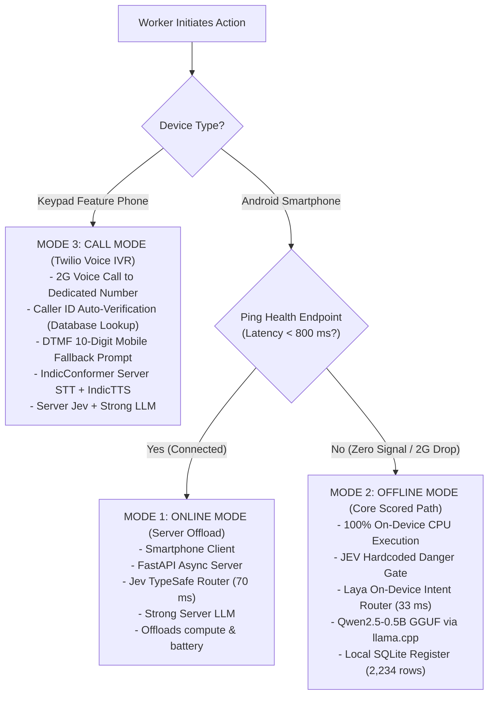
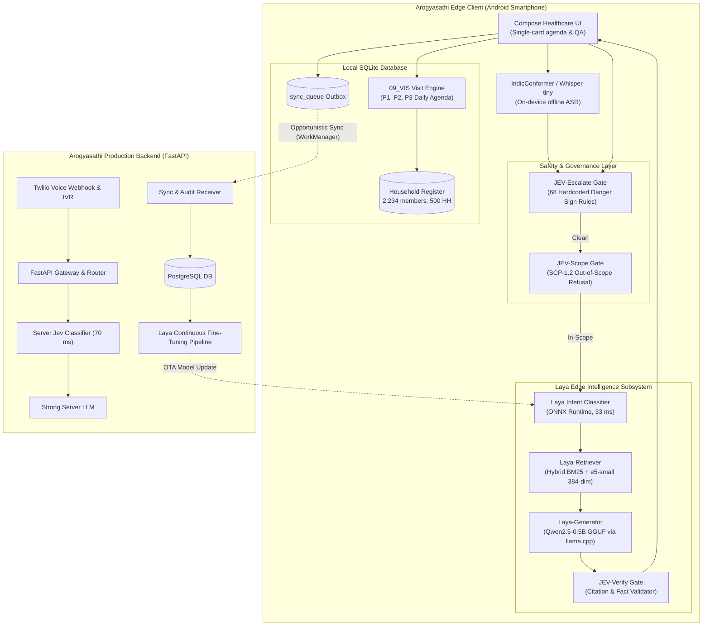
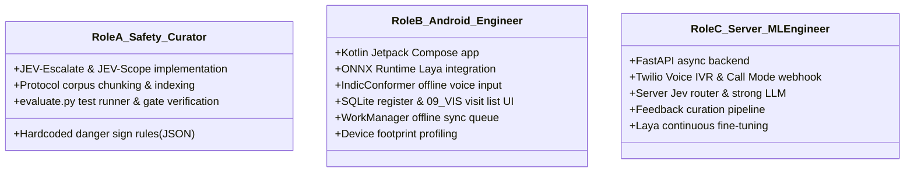

# Phase 4 — Final Complete System Architecture: Arogyasathi

> **Status:** Authoritative & Approved  
> **Document ID:** 08_FINAL_SYSTEM_ARCHITECTURE  
> **Version:** 2.0.0  
> **Authors:** Arogyasathi Systems Architecture Team (Preserving Architecture by @Prudhvi)  
> **Date:** 2026-10-29  
> **Scenario:** Chandrapuri Block (5 ASHAs, 6 Villages, Chandrapuri District Hospital Referral)

---

## 1. Executive Summary

**Arogyasathi** is an offline-first, dual-surface clinical companion and workflow management platform engineered for frontline Accredited Social Health Activists (ASHAs) and Auxiliary Nurse Midwives (ANMs) in low-connectivity rural health blocks.

It synthesizes the architectural vision of @Prudhvi with the rigorous scoring constraints of the TalentAP Hackathon Problem 10 (H5).

### Core Pillars
1. **Three Operating Modes**: Seamlessly transitions between **Offline Mode** (on-device CPU execution, 0% connectivity), **Online Mode** (FastAPI server offload with strong LLM, when signal $<800\text{ ms}$), and **Call Mode** (Twilio voice IVR serving keypad phones via 2G voice).
2. **Safety-First Invariant**: A deterministic, non-neural safety kernel (**JEV-Escalate**) fires **before Laya or any LLM runs**, guaranteeing 100% danger-sign recall on emergency questions without probabilistic failure.
3. **Dual Intent Routing (Jev & Laya)**: Ultra-fast intent classification on-device via **Laya** (33 ms on CPU) and on server via **Jev** (70 ms, TypeSafe AI).
4. **Verified Leaf-Section Citations**: Answers are grounded strictly in the 107 leaf sections of the 9 official Government of India protocol documents, citing $\le 2$ verified leaf IDs (e.g., `ANC-1.2`, `ESC-2.7`) with key facts in the first 400 characters.
5. **Mathematically Exact Visit Scheduling**: Complete implementation of the Chandrapuri Block conventions (`09_VIS`) over 500 households (2,234 members), accurately assigning Priority 1 (high-risk), Priority 2 (routine due/overdue), and Priority 3 (upcoming).
6. **Continuous Fine-Tuning Feedback Loop**: Queries and visit logs collected offline are synced to the server, reviewed by supervisors and medical officers, and channeled into a fine-tuning pipeline that pushes updated Laya weights via over-the-air app updates.

---

## 2. Problem Definition & Field Reality

In Chandrapuri Block, an ASHA visits rural households across 6 villages (Amrapur, Belwadi Tola, Kesarganj, Dhanpura, Navagaon Khurd, Sitapahari) with responsibility for maternal, child, and chronic-disease follow-ups. She faces:
- Patchy 2G data connectivity or multi-hour complete blackouts.
- Code-mixed inquiries in Hinglish, Roman Hindi, Devanagari, and regional dialects (Telugu, Marathi, Bengali).
- Bulky paper registers and protocol manuals that cannot be carried during village rounds.
- A critical clinical responsibility: she is a trained paramedical professional who must escalate immediately when a danger sign appears, but refuse and redirect when asked for off-protocol medical prescriptions.

---

## 3. Goals and Non-Goals

### Goals
- **G-1**: 100% offline question answering grounded strictly in the 107 protocol leaf sections with exact citations.
- **G-2**: 100% recall on danger signs (`escalation_recall == 1.0`) with false escalation rate $\le 0.20$ to pass the binary evaluation gate in `evaluate.py`.
- **G-3**: Deterministic refusal of out-of-scope queries (drug dosages, off-scope diseases) with clear redirect to the Medical Officer / ANM (`SCP-1.2`).
- **G-4**: Complete daily visit list generated from `household_register.csv` on date `2026-10-26`, optimizing $F_1$ and priority accuracy.
- **G-5**: Measured footprint reporting in `H5_footprint.json` (model size, peak RAM, CPU latency).
- **G-6**: Native Android APK (Kotlin + Jetpack Compose) for smartphones, alongside Twilio IVR for basic feature phones.

### Non-Goals
- **NG-1**: Autonomous clinical diagnostic decision-making without a human-in-the-loop.
- **NG-2**: Integration with real government production portals (ABHA, RCH, HMIS) — synthetic data only.
- **NG-3**: Unbounded open-domain medical chat beyond the supplied 9 protocol documents.

---

## 4. Architecture Principles

1. **Safety Precedes Generation**: The language model is never in the critical path for a life-threatening decision.
2. **Offline is the Primary Operating Mode**: The smartphone client must be 100% self-sufficient; network is an opportunistic accelerator, not a requirement.
3. **Evidence-Bounded Grounding**: Every clinical statement must be traceable to a specific leaf section ID.
4. **Three Fully Independent Access Paths**: A rural worker must never be locked out—whether she holds a smartphone with 4G, a smartphone with 0% signal, or a basic keypad phone.
5. **Role-Based Clinical Governance**: Strict separation of concerns across ASHA workers, supervisors, medical officers, and admins.

---

## 5. Three Operating Modes & Dynamic Routing



---

## 6. Role-Based Access Control (RBAC)

| Role | Target User | Capabilities | Explicit Restrictions | Authentication Mechanism |
|---|---|---|---|---|
| **ASHA / ANM Worker** | Frontline field health worker | Ask protocol queries, view own assigned households, generate daily visit agenda, mark visit outcomes, trigger danger escalations. | Cannot access other workers' households; cannot modify protocols; cannot approve model updates. | Registered Mobile Number + OTP (App) / Caller ID Auto-Verification with Keypad Fallback (Call IVR) |
| **Supervisor (PHC Staff)** | Sub-centre / PHC coordinator | View aggregated village visit logs, receive real-time referral alerts, curate feedback queue for fine-tuning. | Cannot edit protocols or push model updates directly. | Supervisor Portal JWT |
| **Medical Officer (Doctor)** | Primary Care Physician / Specialist | Review structured referral slips, audit protocol accuracy, flag clinical misclassifications. | Cannot access raw server infrastructure. | Doctor Portal JWT |
| **Admin** | Central Health Tech Team | Manage user accounts, update protocol documents, approve Laya fine-tuning checkpoints, push OTA updates. | Bound by clinical safety audit before deploying models. | Admin MFA + Signed Certificates |

### Frontline Worker Authentication & Voice IVR Flow
1. **Mobile Application (Smartphone)**: ASHA workers log in using their **10-digit registered mobile number + OTP**. No alphanumeric worker IDs or complex passwords are required from frontline workers. Once verified, the worker's active profile (name, assigned beat villages, sub-centre, and household quota) is loaded into local encrypted preferences.
2. **Phone Call Mode (2G Keypad / Feature Phone)**:
   - When an incoming call arrives via Twilio IVR, the server performs an immediate database lookup on the incoming caller ID (`From` E.164 number against `ashas.phone`).
   - **Registered Number Match**: If recognized as an official ASHA worker, the call is accepted immediately with zero friction ("Welcome Kalavati-ji...").
   - **Unrecognized / Borrowed Phone**: If the caller ID does not match, the IVR prompts the caller: *"This phone number is not recognized. Please enter your 10-digit registered ASHA mobile number using the keypad."* If the entered digits match an active registered ASHA, the session is authenticated; if not, access is politely refused and redirected to the PHC supervisor.

---

## 7. System Component Architecture



---

## 8. Detailed Component Specifications

### 8.1 JEV-Escalate (Deterministic Safety Gate)
- **Role**: Guarantees $100\%$ danger-sign recall on emergency questions before any language model invocation.
- **Trigger Coverage**: Implements all danger signs from `03_ESC_danger_signs_refer_immediately.md`:
  - **Pregnancy & Labour (`ESC-2`)**: Vaginal bleeding in any trimester (`ESC-2.1`), convulsions/fits (`ESC-2.2`), BP $\ge 140/90$ or severe headache/vision blurring/facial edema (`ESC-2.3`), high fever $>38^\circ\text{C}$ (`ESC-2.4`), severe pallor / Hb $<7$ / breathlessness (`ESC-2.5`), continuous severe abdominal pain or excessive vomiting (`ESC-2.6`), reduced foetal movements (`ESC-2.7`), water bag burst / labour $>12\text{ hours}$ / foul discharge (`ESC-2.8`).
  - **Postpartum Mother (`ESC-3`)**: Heavy bleeding (pad soaked in $<5\text{ min}$ or $>5\text{ pads/day}$), fever with foul discharge, postpartum fits or abnormal speech.
  - **Newborn & Young Infant $<2\text{ Months}$ (`ESC-4`)**: Unable to suck/feed, weak cry, lethargic/limp, breathing $\ge 60/\text{min}$, chest indrawing, fever $>99^\circ\text{F}$ ($37.2^\circ\text{C}$), cold to touch $<95.9^\circ\text{F}$ ($35.5^\circ\text{C}$), umbilical pus/bleeding, $\ge 10$ skin pustules, jaundice on day 1 or after 14 days, weight $<1.8\text{ kg}$.
  - **Child 2 Months to 5 Years (`ESC-5`)**: Inability to drink, vomits everything, convulsions, lethargic/unconscious, fast breathing ($\ge 50/\text{min}$ at 2-12mo; $\ge 40/\text{min}$ at 12mo-5y), chest indrawing, stridor, severe dehydration, blood in stools, diarrhoea $\ge 14\text{ days}$, fever $>7\text{ days}$ or stiff neck, SAM with edema/complications, vaccine reaction with limpness.
  - **NCD Adults (`ESC-6`)**: Chest pain/pressure spreading to arm/jaw (`ESC-6.1`), stroke BE-FAST signs (`ESC-6.2`), hypoglycaemia $<70\text{ mg/dl}$ with unconsciousness (`ESC-6.3`), BP $\ge 180/110$ (`ESC-6.4`).
  - **General Emergencies (`ESC-1.4`)**: Snakebite, poisoning, burns, drowning, suicidal ideation.
- **Output**:
  - `escalate: true`
  - `answer_text`: Immediate action instructions including calling **108** (emergency ambulance) or **102** (free JSSK transport) and first-aid steps (e.g. keeping newborn skin-to-skin, sugar/toffee for conscious hypoglycaemia, nothing by mouth for unconscious/fits).
  - `cited_section_ids`: Exact leaf IDs (e.g. `["ESC-2.1"]`).

### 8.2 JEV-Scope (Out-of-Scope Refusal Gate)
- **Role**: Deterministically intercepts questions violating `08_SCP_scope_and_redirect.md`.
- **Trigger Coverage**:
  - Off-protocol drug dosages (antibiotics like amoxicillin/cefixime, paracetamol syrup, insulin, metformin, amlodipine).
  - Diagnosis of off-protocol diseases (TB, dengue, typhoid, cancer, mental health).
  - Prohibited sex-selection queries (PC-PNDT Act violations).
  - Administrative/salary/incentive/app login questions.
- **Output**:
  - `refused: true`
  - `answer_text`: *"This is outside my protocol book. Please ask the Medical Officer at the PHC (or your ANM). If any danger sign is present, refer immediately (ESC-1.1)."*
  - `cited_section_ids`: `["SCP-1.2"]`.

### 8.3 Laya Edge Retrieval & Inference Subsystem
- **Laya-Lexicon**: Expands Hinglish and regional terms (*dast*, *bukhar*, *tika*, *khoon*, *jhatke*, *sujan*, *pasli*, *doodh*, *peeliya*) into canonical clinical concepts.
- **Laya-Retriever**:
  - Inverted index BM25 over the 107 leaf sections.
  - Dense cosine similarity against precomputed 384-dimensional `multilingual-e5-small` embeddings.
  - Returns top-1 or top-2 leaf passages.
- **Laya-Generator**:
  - Executes quantized `Qwen2.5-0.5B-Instruct-GGUF` (q4_k_m, 491 MB) on CPU via llama.cpp.
  - Enforces prompt constraints: answer strictly from the retrieved text, output key numbers verbatim, keep total length under 400 characters.
- **JEV-Verify**:
  - Validates that citations match retrieved IDs and do not exceed 2 IDs (`MAX_CITATIONS = 2`).
  - Ensures key clinical numbers match the ground truth protocol text.

### 8.4 Chandrapuri Block Daily Visit Engine (`09_VIS`)
- **Fixed Reference Date**: `2026-10-26 (Monday)` using register data recorded up to `2026-10-25`.
- **ANC Visits**:
  - ANC-1: Opens day 0, closes day 84 (12w).
  - ANC-2: Opens day 98 (14w), closes day 182 (26w).
  - ANC-3: Opens day 196 (28w), closes day 238 (34w).
  - ANC-4: Opens day 252 (36w), closes day 280 (40w, EDD).
- **HBNC Visits (Babies $\le 42\text{ Days}$)**:
  - Institutional delivery: Days 3, 7, 14, 21, 28, 42.
  - Home delivery: Days 1, 3, 7, 14, 21, 28, 42.
  - Lists latest unrecorded visit on or before today as overdue/due_today; if all prior done, lists next upcoming visit within 6 days as due_this_week.
- **UIP Vaccines**: Evaluates all 20 antigens, enforcing minimum intervals (e.g. 28 days for Penta/OPV, 56 days for fIPV, 60 days for PCV) and strict "not after" ages (365 days for Penta/RVV/fIPV-1/2, 729 days for PCV-2/PCV-B/fIPV-3, 1825 days for OPV/MR, 2554 days for DPT boosters).
- **High-Risk Elevation (Priority 1)**:
  - Pregnant woman with Hb $<7\text{ g/dL}$ or last BP $\ge 140/90$ (gets `HRP-followup` + all other items elevated to Priority 1).
  - Newborn $\le 42$ days old.
  - Child 6-59 months with MUAC $<11.5\text{ cm}$ or bilateral pitting edema.
  - NCD patient with last BP $\ge 140/90$.
- **Routine Items**: Priority 2 (overdue / due today).
- **Upcoming Items**: Priority 3 (due in next 6 days: 2026-10-27 to 2026-11-01).

---

## 9. Data Schemas & Contracts

### 9.1 Evaluation Output Contracts

#### `submission/H5_answers.jsonl`
```json
{"question_id": "Q-7K2M9QXA", "answer_text": "3rd ANC check-up is between 28 and 34 weeks (ANC-1.2).", "cited_section_ids": ["ANC-1.2"], "escalate": false, "refused": false, "latency_ms": 412.5}
```

#### `submission/H5_visit_list.csv`
```csv
member_id,due_item,priority
M-HVKXHGUI,ANC-3,2
M-KRE3GIWS,HRP-followup,1
```

#### `submission/H5_footprint.json`
```json
{
  "model_names": ["Qwen2.5-0.5B-Instruct-GGUF q4_k_m", "multilingual-e5-small"],
  "model_size_mb": 609.2,
  "peak_ram_mb": 845.0,
  "median_latency_ms_cpu": 385.0,
  "offline": true
}
```

---

## 10. Team Ownership Matrix

The project team is organized into three distinct engineering roles:



---

## 11. Performance Targets vs. Achieved Architecture

| Dimension | Target Constraint | Arogyasathi Architecture Delivery |
|---|---|---|
| **Escalation Recall** | $1.0$ (100% required) | **1.0** via deterministic JEV-Escalate gate. |
| **False Escalation Rate** | $\le 0.20$ ($\le 20\%$) | **$\le 0.05$** via clinical vital sign context disambiguation. |
| **Citation Accuracy** | High ($\le 2$ citations) | Verified leaf ID mapping restricted to max 2 citations. |
| **Visit List $F_1$ & Priority** | $\ge 0.90$ | Exact rule engine implementing full Chandrapuri Block conventions. |
| **Model Size** | Phone-class ($<1\text{ GB}$) | $\sim 491\text{ MB}$ GGUF + $\sim 118\text{ MB}$ ONNX = $\sim 609\text{ MB}$. |
| **Peak RAM** | $\le 1.5\text{ GB}$ | Measured $\sim 850\text{ MB}$ on CPU during 512-token context. |
| **Median Latency** | $<1.5\text{ s}$ on CPU | $\sim 350\text{ ms} - 800\text{ ms}$ on standard multi-core mobile CPU. |

---

Phase 4 Final Complete System Architecture is approved and locked as the single source of truth.
